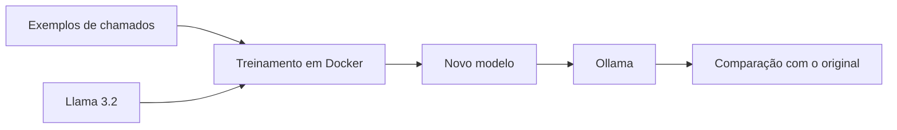
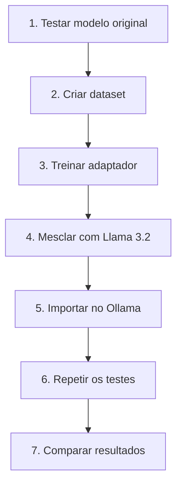
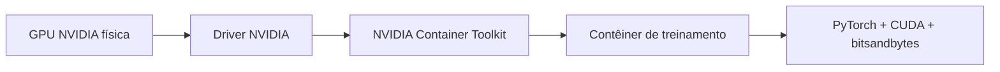

# Encontro 15 — Treinamento do Llama 3.2

## Tema

Ajuste do Llama 3.2 com exemplos de chamados, execução do treinamento em Docker e importação do modelo resultante no Ollama.

## Objetivos

- preparar exemplos de entrada e resposta;
- ajustar o Llama 3.2 para uma tarefa específica;
- executar o treinamento em um contêiner;
- importar o resultado no Ollama;
- comparar o modelo original com o modelo ajustado;
- utilizar o novo modelo no backend.

## O que será construído?

O modelo original continuará disponível:

```text
llama3.2:latest
```

Um segundo modelo será criado:

```text
llama3.2-suporte:latest
```

O novo modelo será ajustado para classificar chamados em:

- `ACESSO`;
- `FINANCEIRO`;
- `DOCUMENTOS`;
- `SISTEMA`.



## Conceitos 

| Termo | Significado neste tutorial |
|---|---|
| modelo-base | Llama 3.2 original usado como ponto de partida |
| dataset | arquivo com exemplos de chamados e respostas esperadas |
| ajuste fino | continuação do treinamento para ensinar uma tarefa específica |
| QLoRA | técnica que reduz a memória necessária e treina apenas uma pequena parte adicional |
| adaptador | arquivo pequeno que guarda o que foi aprendido no ajuste |
| modelo mesclado | modelo-base combinado com o adaptador, pronto para ser importado |

O modelo instalado pelo Ollama é preparado para responder prompts. Ele será usado na comparação, mas não será treinado diretamente. O contêiner de treinamento baixará o checkpoint equivalente, criará um adaptador e produzirá um modelo completo para o Ollama.

## Visão geral



## Pré-requisitos

- Docker e Docker Compose;
- Ollama executado por Docker;
- `llama3.2:latest` ou `llama3.2:3b` instalado;
- GPU NVIDIA disponível para o Docker durante o treinamento;
- NVIDIA Container Toolkit para expor essa GPU ao contêiner;
- espaço para o download e para o modelo resultante;
- conta no Hugging Face com acesso ao Llama 3.2.

### Por que o tutorial pede uma GPU NVIDIA?

A GPU é necessária somente para a etapa de treinamento adotada neste tutorial. Ela não é obrigatória para executar o Ollama ou fazer perguntas ao modelo.

| Operação | GPU NVIDIA obrigatória? | Observação |
|---|:---:|---|
| executar o Llama 3.2 no Ollama | não | o Ollama pode utilizar CPU, embora a resposta possa ser mais lenta |
| consumir o modelo pelo backend | não | o backend apenas chama a API do Ollama |
| criar e testar prompts | não | é uma operação de inferência |
| treinar com o script QLoRA deste material | sim | PyTorch, CUDA e bitsandbytes utilizam a GPU para os cálculos do treinamento |
| importar o modelo treinado no Ollama | não | a importação apenas registra os pesos produzidos |

Durante o treinamento, o modelo precisa calcular muitas operações e manter dados intermediários na memória. A GPU executa essas operações de forma paralela e sua memória, chamada de VRAM, armazena o modelo quantizado e os cálculos necessários.

O Docker não cria nem simula uma GPU. A opção:

```yaml
gpus: all
```

apenas permite que o contêiner utilize uma GPU existente no computador. O **NVIDIA Container Toolkit** conecta o Docker ao driver NVIDIA instalado no sistema operacional.



### E se o computador não tiver uma GPU NVIDIA?

Existem três possibilidades:

1. continuar usando o Llama 3.2 no Ollama sem realizar o treinamento;
2. executar o contêiner de treinamento em outro computador ou serviço que possua GPU e depois importar o resultado no Ollama local;
3. adaptar todo o ambiente para outra tecnologia, como ROCm em GPUs AMD ou MLX em computadores Apple, o que exige imagens, bibliotecas e código diferentes.

Treinamento em CPU é tecnicamente possível em alguns cenários, especialmente com modelos menores, mas pode consumir muita memória e demorar excessivamente. Por isso, ele não é o caminho adotado neste guia.

O tutorial utiliza:

```text
meta-llama/Llama-3.2-3B-Instruct
```

Se o computador não possuir GPU compatível, o restante do projeto e o modelo original continuam funcionando. O treinamento deverá ser realizado em um ambiente com GPU e o adaptador resultante poderá ser trazido de volta. A mesclagem pode utilizar CPU, desde que o computador possua RAM suficiente.

## Estrutura dos arquivos

Na raiz do projeto, crie:

```text
treinamento/
├── Dockerfile
├── requirements.txt
├── train.py
├── merge.py
├── Modelfile
├── dataset/
│   ├── treino.jsonl
│   └── validacao.jsonl
└── output/
    ├── adapter/
    └── merged/
```

Adicione ao `.gitignore`:

```gitignore
.env
treinamento/output/
treinamento/.cache/
```

Não envie tokens, cache ou pesos do modelo ao GitHub.

## Passo 1 — registrar o comportamento do modelo original

Confirme o modelo:

```bash
docker compose exec ollama ollama list
```

No Thunder Client, crie:

```http
POST http://localhost:11434/api/chat
Content-Type: application/json
```

```json
{
  "model": "llama3.2:latest",
  "messages": [
    {
      "role": "user",
      "content": "Classifique o chamado usando ACESSO, FINANCEIRO, DOCUMENTOS ou SISTEMA: Minha conta foi bloqueada."
    }
  ],
  "stream": false,
  "options": {
    "temperature": 0.2,
    "seed": 42
  }
}
```

Salve a resposta. Repita com exemplos de todas as categorias. Esses casos serão usados novamente depois do treinamento e não devem ser copiados para o dataset.

## Passo 2 — obter acesso ao checkpoint

O modelo para treinamento será baixado do Hugging Face:

1. entre em sua conta;
2. abra a página `meta-llama/Llama-3.2-3B-Instruct`;
3. aceite os termos;
4. crie um token pessoal somente para leitura;
5. salve-o em `.env`.

```dotenv
HF_TOKEN=hf_substitua_pelo_token_pessoal
```

O token não deve aparecer no Dockerfile, no Compose, em prints ou commits.

## Passo 3 — criar os exemplos

Crie `treinamento/dataset/treino.jsonl`. Cada linha deve conter uma conversa completa:

```json
{"messages":[{"role":"system","content":"Classifique chamados. Responda com CATEGORIA e JUSTIFICATIVA curta."},{"role":"user","content":"Meu usuário foi bloqueado após várias tentativas."},{"role":"assistant","content":"CATEGORIA: ACESSO\nJUSTIFICATIVA: bloqueio de credenciais."}]}
{"messages":[{"role":"system","content":"Classifique chamados. Responda com CATEGORIA e JUSTIFICATIVA curta."},{"role":"user","content":"O boleto deste mês veio com valor incorreto."},{"role":"assistant","content":"CATEGORIA: FINANCEIRO\nJUSTIFICATIVA: divergência em cobrança."}]}
{"messages":[{"role":"system","content":"Classifique chamados. Responda com CATEGORIA e JUSTIFICATIVA curta."},{"role":"user","content":"Preciso de uma declaração de matrícula."},{"role":"assistant","content":"CATEGORIA: DOCUMENTOS\nJUSTIFICATIVA: solicitação de documento acadêmico."}]}
{"messages":[{"role":"system","content":"Classifique chamados. Responda com CATEGORIA e JUSTIFICATIVA curta."},{"role":"user","content":"O portal fecha quando envio o formulário."},{"role":"assistant","content":"CATEGORIA: SISTEMA\nJUSTIFICATIVA: falha durante operação do portal."}]}
```

Os quatro registros mostram o formato, mas são insuficientes para avaliar melhoria. Acrescente ao menos cinco exemplos diferentes por categoria.

Crie `treinamento/dataset/validacao.jsonl` com outros exemplos:

```json
{"messages":[{"role":"system","content":"Classifique chamados. Responda com CATEGORIA e JUSTIFICATIVA curta."},{"role":"user","content":"A recuperação de senha não envia o código."},{"role":"assistant","content":"CATEGORIA: ACESSO\nJUSTIFICATIVA: problema na recuperação de credenciais."}]}
{"messages":[{"role":"system","content":"Classifique chamados. Responda com CATEGORIA e JUSTIFICATIVA curta."},{"role":"user","content":"Não consigo abrir a página de notas."},{"role":"assistant","content":"CATEGORIA: SISTEMA\nJUSTIFICATIVA: indisponibilidade de funcionalidade do portal."}]}
```

Regras simples:

- não use dados pessoais reais;
- não coloque o mesmo exemplo nos dois arquivos;
- mantenha quantidade semelhante por categoria;
- revise categorias e justificativas.

## Passo 4 — preparar o contêiner

Crie `treinamento/requirements.txt`:

```text
transformers>=4.45,<5
datasets>=3,<5
peft>=0.13,<1
trl>=0.15,<1
accelerate>=1,<2
bitsandbytes>=0.44,<1
safetensors>=0.4,<1
sentencepiece>=0.2,<1
```

Crie `treinamento/Dockerfile`:

```dockerfile
FROM pytorch/pytorch:2.6.0-cuda12.4-cudnn9-runtime

WORKDIR /workspace

COPY requirements.txt .
RUN pip install --no-cache-dir -r requirements.txt

COPY . .

CMD ["python", "train.py"]
```

Adicione o serviço `trainer` ao `compose.yaml`:

```yaml
services:
  ollama:
    volumes:
      - ollama-data:/root/.ollama
      - ./treinamento/output/merged:/models/llama32-suporte:ro
      - ./treinamento/Modelfile:/models/Modelfile:ro

  trainer:
    profiles: ["training"]
    build:
      context: ./treinamento
    environment:
      HF_TOKEN: ${HF_TOKEN}
      BASE_MODEL: meta-llama/Llama-3.2-3B-Instruct
    volumes:
      - ./treinamento:/workspace
      - huggingface-cache:/root/.cache/huggingface
    gpus: all
    ipc: host

volumes:
  ollama-data:
  huggingface-cache:
```

Preserve as demais configurações já existentes no serviço `ollama`. A opção `gpus: all` não instala drivers nem fornece uma GPU remota: ela apenas disponibiliza ao contêiner a GPU NVIDIA já presente no computador.

Construa o contêiner e confirme a GPU:

```bash
docker compose --profile training build trainer
docker compose --profile training run --rm trainer nvidia-smi
```

## Passo 5 — criar o script de treinamento

Crie `treinamento/train.py`:

```python
import os
import torch
from datasets import load_dataset
from peft import LoraConfig, prepare_model_for_kbit_training
from transformers import (
    AutoModelForCausalLM,
    AutoTokenizer,
    BitsAndBytesConfig,
)
from trl import SFTConfig, SFTTrainer

MODEL_ID = os.getenv(
    "BASE_MODEL",
    "meta-llama/Llama-3.2-3B-Instruct",
)
TOKEN = os.environ["HF_TOKEN"]

if not torch.cuda.is_available():
    raise RuntimeError("GPU CUDA não encontrada")

use_bf16 = torch.cuda.is_bf16_supported()
compute_type = torch.bfloat16 if use_bf16 else torch.float16

dataset = load_dataset(
    "json",
    data_files={
        "train": "/workspace/dataset/treino.jsonl",
        "validation": "/workspace/dataset/validacao.jsonl",
    },
)

tokenizer = AutoTokenizer.from_pretrained(MODEL_ID, token=TOKEN)
if tokenizer.pad_token is None:
    tokenizer.pad_token = tokenizer.eos_token

model = AutoModelForCausalLM.from_pretrained(
    MODEL_ID,
    token=TOKEN,
    device_map="auto",
    quantization_config=BitsAndBytesConfig(
        load_in_4bit=True,
        bnb_4bit_quant_type="nf4",
        bnb_4bit_use_double_quant=True,
        bnb_4bit_compute_dtype=compute_type,
    ),
)
model.config.use_cache = False
model = prepare_model_for_kbit_training(model)

lora = LoraConfig(
    r=16,
    lora_alpha=32,
    lora_dropout=0.05,
    bias="none",
    task_type="CAUSAL_LM",
    target_modules=["q_proj", "k_proj", "v_proj", "o_proj"],
)

config = SFTConfig(
    output_dir="/workspace/output/checkpoints",
    num_train_epochs=3,
    per_device_train_batch_size=1,
    per_device_eval_batch_size=1,
    gradient_accumulation_steps=4,
    learning_rate=2e-4,
    eval_strategy="epoch",
    save_strategy="epoch",
    logging_steps=1,
    max_length=512,
    bf16=use_bf16,
    fp16=not use_bf16,
    report_to="none",
    seed=42,
)

trainer = SFTTrainer(
    model=model,
    args=config,
    train_dataset=dataset["train"],
    eval_dataset=dataset["validation"],
    processing_class=tokenizer,
    peft_config=lora,
)

trainer.train()
trainer.model.save_pretrained("/workspace/output/adapter")
tokenizer.save_pretrained("/workspace/output/adapter")
```

O script:

1. abre o dataset;
2. carrega o Llama 3.2 com menor consumo de memória;
3. treina o adaptador;
4. salva o resultado em `output/adapter`.

Não altere vários parâmetros ao mesmo tempo. Primeiro execute o exemplo e registre o resultado.

## Passo 6 — executar o treinamento

```bash
docker compose --profile training run --rm trainer python train.py
```

Ao terminar, confirme:

```bash
ls treinamento/output/adapter
```

Devem existir arquivos como:

- `adapter_config.json`;
- `adapter_model.safetensors`;
- arquivos do tokenizer.

Se a perda de treino diminuir enquanto a perda de validação piora, o modelo pode estar memorizando os exemplos.

## Passo 7 — gerar o modelo completo

Crie `treinamento/merge.py`:

```python
import os
import torch
from peft import PeftModel
from transformers import AutoModelForCausalLM, AutoTokenizer

MODEL_ID = os.getenv(
    "BASE_MODEL",
    "meta-llama/Llama-3.2-3B-Instruct",
)
TOKEN = os.environ["HF_TOKEN"]

base = AutoModelForCausalLM.from_pretrained(
    MODEL_ID,
    token=TOKEN,
    torch_dtype=torch.float16,
    device_map="cpu",
    low_cpu_mem_usage=True,
)

model = PeftModel.from_pretrained(
    base,
    "/workspace/output/adapter",
)
model = model.merge_and_unload()

model.save_pretrained(
    "/workspace/output/merged",
    safe_serialization=True,
    max_shard_size="2GB",
)

tokenizer = AutoTokenizer.from_pretrained(MODEL_ID, token=TOKEN)
tokenizer.save_pretrained("/workspace/output/merged")
```

Execute:

```bash
docker compose --profile training run --rm trainer python merge.py
```

O diretório `output/merged` conterá o modelo completo. Essa etapa pode utilizar bastante RAM.

## Passo 8 — importar no Ollama

Crie `treinamento/Modelfile`:

```text
FROM /models/llama32-suporte

PARAMETER temperature 0.2
PARAMETER num_ctx 4096

SYSTEM """
Você classifica chamados de suporte.
Use somente: ACESSO, FINANCEIRO, DOCUMENTOS ou SISTEMA.
Responda com CATEGORIA e JUSTIFICATIVA curta.
"""
```

Recrie o contêiner para aplicar os volumes e importe:

```bash
docker compose up -d --force-recreate ollama
docker compose exec ollama ollama create llama3.2-suporte -f /models/Modelfile
docker compose exec ollama ollama list
```

O novo nome deve aparecer sem remover o modelo original.

## Passo 9 — comparar os modelos

No Thunder Client, repita os testes do Passo 1 alterando somente `model`:

```json
{
  "model": "llama3.2-suporte",
  "messages": [
    {
      "role": "user",
      "content": "Classifique: Minha conta foi bloqueada."
    }
  ],
  "stream": false,
  "options": {
    "temperature": 0.2,
    "seed": 42
  }
}
```

Preencha:

| Caso | Esperado | Modelo original | Modelo ajustado |
|---|---|---|---|
| problema de senha | ACESSO |  |  |
| cobrança duplicada | FINANCEIRO |  |  |
| solicitação de histórico | DOCUMENTOS |  |  |
| erro no portal | SISTEMA |  |  |
| texto ambíguo | reconhecer dúvida |  |  |
| assunto fora do domínio | não inventar categoria |  |  |

Uma resposta conhecida do dataset não comprova melhoria. Utilize textos novos e variações de vocabulário.

## Usar no backend

Altere somente a configuração:

```yaml
environment:
  OLLAMA_MODEL: llama3.2-suporte
```

Recrie o backend:

```bash
docker compose up -d --force-recreate backend
```

O código NestJS continua igual porque o nome do modelo é fornecido pelo ambiente.

## Problemas comuns

| Problema | Verificação |
|---|---|
| acesso negado ao checkpoint | termos aceitos e token de leitura válido |
| GPU não encontrada | driver e NVIDIA Container Toolkit |
| falta de memória na GPU | reduzir `max_length` ou usar consistentemente a variante 1B |
| arquivo de adaptador não criado | logs do treinamento e permissões de `output/` |
| mesclagem encerra por memória | RAM disponível no host |
| Ollama não encontra os pesos | volumes, caminho do `FROM` e conteúdo de `merged/` |
| modelo ajustado piorou | dataset pequeno, inconsistente ou com categorias desbalanceadas |

Para conferir GPU:

```bash
docker compose --profile training run --rm trainer nvidia-smi
```

Para conferir os arquivos vistos pelo Ollama:

```bash
docker compose exec ollama ls /models/llama32-suporte
```

## Atividade prática individual

Realize o fluxo e entregue:

1. dataset de treino e validação sem dados pessoais;
2. configurações do contêiner;
3. registro dos comandos utilizados;
4. tabela comparando os dois modelos;
5. análise de um acerto e de um erro;
6. decisão: manter, revisar ou descartar o modelo ajustado.

A entrega será realizada pelo repositório GitHub enviado no Classroom. Não envie `.env`, token, cache, adaptadores ou pesos.

## Checklist

- [ ] modelo original foi testado;
- [ ] exemplos de comparação não aparecem no treino;
- [ ] token está fora do Git;
- [ ] GPU está disponível no contêiner;
- [ ] adaptador foi criado;
- [ ] modelo completo foi gerado;
- [ ] novo modelo foi importado no Ollama;
- [ ] modelos foram comparados com as mesmas configurações;
- [ ] erros e limitações foram registrados.

## Síntese

O experimento parte do Llama 3.2, apresenta exemplos da tarefa, treina um pequeno adaptador, gera um modelo completo e o importa no Ollama. O resultado só deve ser considerado melhor quando superar o modelo original em exemplos que não participaram do treinamento.

## Fontes oficiais

- [Llama 3.2 da Meta](https://huggingface.co/meta-llama/Llama-3.2-3B-Instruct)
- [Treinamento com TRL](https://huggingface.co/docs/trl/sft_trainer)
- [PEFT e LoRA](https://huggingface.co/docs/peft/quicktour)
- [Importação no Ollama](https://docs.ollama.com/import)
- [Modelfile do Ollama](https://docs.ollama.com/modelfile)
