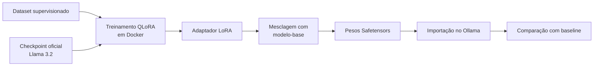
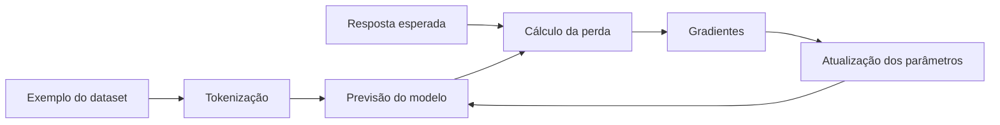
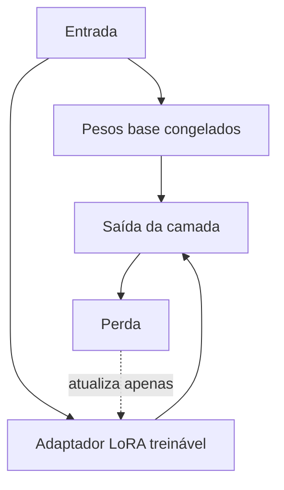

# Encontro 15 — Treinamento e ajuste fino do Llama 3.2

## Tema

Fundamentos de treinamento de modelos de linguagem e tutorial de ajuste fino supervisionado do Llama 3.2 com QLoRA, executado em Docker e posteriormente importado no Ollama.

## Objetivos

- diferenciar pré-treinamento, ajuste fino, alinhamento e inferência;
- entender o papel de dataset, tokenização, função de perda, épocas e validação;
- reconhecer por que o modelo instalado no Ollama não é treinado diretamente;
- preparar um dataset supervisionado sem misturar exemplos de avaliação;
- treinar um adaptador QLoRA sobre o Llama 3.2;
- mesclar o adaptador aos pesos do modelo-base;
- importar o modelo resultante no Ollama;
- comparar baseline e modelo ajustado com critérios observáveis.

## Resultado esperado

O fluxo produzirá um novo modelo local:

```text
llama3.2-suporte:latest
```

O modelo será especializado em classificar chamados e devolver uma resposta curta e estruturada. O modelo original permanecerá disponível para comparação.



### Legenda do fluxo

| Componente | Resumo |
|---|---|
| dataset supervisionado | conjunto de exemplos contendo entradas e respostas esperadas para orientar a especialização |
| checkpoint oficial Llama 3.2 | pesos originais do modelo-base em formato adequado para treinamento |
| treinamento QLoRA em Docker | processo que mantém o modelo-base quantizado e atualiza somente pequenos parâmetros adicionais dentro do contêiner |
| adaptador LoRA | arquivo compacto com as alterações aprendidas durante o ajuste fino |
| mesclagem com o modelo-base | incorporação das alterações do adaptador aos pesos originais para formar um modelo completo |
| pesos Safetensors | arquivos resultantes em um formato seguro e suportado para armazenamento e importação |
| importação no Ollama | registro dos pesos mesclados como um novo modelo disponível para inferência local |
| comparação com baseline | avaliação do modelo ajustado contra o modelo original usando os mesmos exemplos e configurações |

O dataset e o checkpoint entram no treinamento, mas somente o adaptador é alterado nessa etapa. Depois da mesclagem, o Ollama recebe um modelo completo e independente do ambiente usado para treinar.

## O que significa treinar um modelo?

Durante o treinamento, o modelo recebe sequências de tokens e tenta prever os tokens esperados. A diferença entre previsão e resposta correta é representada por uma função de perda. O otimizador utiliza essa perda para atualizar parâmetros.



O processo não consiste em copiar frases para uma memória consultável. O treinamento altera valores numéricos para aumentar a probabilidade de determinados padrões.

## Etapas diferentes do ciclo de um modelo

| Etapa | O que acontece | Escala típica |
|---|---|---|
| pré-treinamento | aprendizado geral a partir de grande volume de dados | muito elevada |
| ajuste fino supervisionado | especialização com pares de entrada e saída | menor e direcionada |
| alinhamento por preferências | comparação de respostas e otimização de comportamento | depende da técnica |
| inferência | uso dos pesos para produzir uma resposta | não atualiza pesos |
| RAG | informação externa é adicionada ao contexto | não treina o modelo |

Neste encontro será realizado ajuste fino supervisionado, conhecido como SFT.

## LoRA e QLoRA

Treinar todos os parâmetros de um modelo exige muita memória. LoRA congela os pesos do modelo-base e treina pequenas matrizes adicionais em determinadas camadas.

QLoRA combina:

- modelo-base carregado com quantização de 4 bits;
- pesos originais congelados;
- adaptadores LoRA treináveis;
- cálculo em precisão adequada à GPU;
- mesclagem posterior com o modelo-base.



QLoRA reduz memória, mas não elimina a necessidade de GPU, armazenamento, RAM e avaliação.

## Por que o arquivo instalado no Ollama não será treinado diretamente?

O modelo obtido por `ollama pull` é preparado e geralmente quantizado para inferência. O Ollama executa, organiza e importa modelos, mas não oferece um comando `ollama train`.

O treinamento precisa de:

- checkpoint compatível com bibliotecas de treinamento;
- estados e tensores adequados ao cálculo de gradientes;
- otimizador e laço de treinamento;
- dataset tokenizado;
- framework como PyTorch, Transformers, TRL e PEFT.

O modelo já instalado será utilizado como baseline. O contêiner de treinamento baixará o checkpoint oficial correspondente e produzirá novos pesos.

## Limites do tutorial

Este é um experimento didático de especialização, não um treinamento de produção.

- poucos exemplos podem causar memorização;
- redução da perda não garante melhoria real;
- um dataset enviesado transfere o viés ao comportamento;
- o modelo pode piorar em tarefas gerais;
- QLoRA não adiciona fatos atualizados de forma confiável;
- dados sigilosos não devem ser usados;
- a licença do modelo e dos dados precisa ser respeitada.

## Pré-requisitos

- Docker e Docker Compose;
- Ollama já executado pelo Compose;
- Llama 3.2 instalado no Ollama;
- GPU NVIDIA compatível com CUDA;
- NVIDIA Container Toolkit configurado no Docker;
- espaço para checkpoint, cache, adaptador e modelo mesclado;
- conta no Hugging Face com acesso aceito ao checkpoint da Meta.

O exemplo utiliza:

```text
meta-llama/Llama-3.2-3B-Instruct
```

Em hardware mais limitado, é possível trocar de maneira consistente para:

```text
meta-llama/Llama-3.2-1B-Instruct
llama3.2:1b
```

Checkpoint de treinamento e modelo usado como baseline devem pertencer à mesma variante.

## Estrutura do experimento

```text
treinamento/
├── Dockerfile
├── requirements.txt
├── train.py
├── merge.py
├── Modelfile
├── dataset/
│   ├── treino.jsonl
│   └── validacao.jsonl
└── output/
    ├── adapter/
    └── merged/
```

`output/` e o cache de modelos não devem ser enviados ao Git.

## Passo 1 — confirmar o modelo usado como baseline

```bash
docker compose exec ollama ollama list
docker compose exec ollama ollama show llama3.2:latest
```

Registre o identificador completo. Se o ambiente utiliza `llama3.2:3b`, mantenha o checkpoint 3B neste tutorial.

Crie um conjunto de perguntas de avaliação antes do treinamento:

| Entrada | Saída desejada |
|---|---|
| “Não consigo redefinir minha senha.” | `ACESSO` |
| “A mensalidade foi cobrada duas vezes.” | `FINANCEIRO` |
| “Preciso emitir meu histórico.” | `DOCUMENTOS` |
| “A tela fica branca depois do login.” | `SISTEMA` |

Execute-as no baseline e salve as respostas. Esses exemplos não devem aparecer no treinamento.

## Passo 2 — preparar o acesso ao checkpoint

Na página do modelo no Hugging Face:

1. entre com sua conta pessoal;
2. aceite os termos do Llama 3.2;
3. crie um token de leitura;
4. guarde o token apenas no arquivo `.env`.

```dotenv
HF_TOKEN=hf_substitua_pelo_token_pessoal
```

Inclua no `.gitignore`:

```gitignore
.env
treinamento/output/
treinamento/.cache/
```

O token não deve ser escrito no Dockerfile, no Compose ou no repositório. Revogue-o após o experimento se ele não for mais necessário.

## Passo 3 — criar o dataset

Crie `treinamento/dataset/treino.jsonl`. Cada linha é um objeto JSON completo:

```json
{"messages":[{"role":"system","content":"Classifique chamados. Responda somente com CATEGORIA e JUSTIFICATIVA curta."},{"role":"user","content":"Meu usuário foi bloqueado após várias tentativas."},{"role":"assistant","content":"CATEGORIA: ACESSO\nJUSTIFICATIVA: bloqueio de credenciais."}]}
{"messages":[{"role":"system","content":"Classifique chamados. Responda somente com CATEGORIA e JUSTIFICATIVA curta."},{"role":"user","content":"O boleto deste mês aparece com valor incorreto."},{"role":"assistant","content":"CATEGORIA: FINANCEIRO\nJUSTIFICATIVA: divergência em cobrança."}]}
{"messages":[{"role":"system","content":"Classifique chamados. Responda somente com CATEGORIA e JUSTIFICATIVA curta."},{"role":"user","content":"Solicito uma declaração de matrícula."},{"role":"assistant","content":"CATEGORIA: DOCUMENTOS\nJUSTIFICATIVA: solicitação de documento acadêmico."}]}
{"messages":[{"role":"system","content":"Classifique chamados. Responda somente com CATEGORIA e JUSTIFICATIVA curta."},{"role":"user","content":"O portal fecha quando envio o formulário."},{"role":"assistant","content":"CATEGORIA: SISTEMA\nJUSTIFICATIVA: falha durante operação do portal."}]}
```

Essas linhas demonstram o formato, mas não formam um dataset suficiente. Acrescente exemplos variados, escritos de formas diferentes e distribuídos entre todas as categorias.

Crie `validacao.jsonl` com exemplos distintos. Não copie ou parafraseie mecanicamente o conjunto de treino.

### Qualidade do dataset

Verifique:

- categorias equilibradas;
- respostas consistentes;
- ausência de senhas, tokens e dados pessoais;
- exemplos ambíguos identificados;
- variação de vocabulário e tamanho;
- separação real entre treino e validação;
- origem e permissão de uso dos dados.

## Passo 4 — criar a imagem de treinamento

Crie `treinamento/requirements.txt`:

```text
transformers>=4.45,<5
datasets>=3,<5
peft>=0.13,<1
trl>=0.15,<1
accelerate>=1,<2
bitsandbytes>=0.44,<1
safetensors>=0.4,<1
sentencepiece>=0.2,<1
```

Crie `treinamento/Dockerfile`:

```dockerfile
FROM pytorch/pytorch:2.6.0-cuda12.4-cudnn9-runtime

WORKDIR /workspace

COPY requirements.txt .
RUN pip install --no-cache-dir -r requirements.txt

COPY . .

CMD ["python", "train.py"]
```

A imagem possui CUDA e PyTorch. As outras bibliotecas implementam carregamento do checkpoint, dataset, QLoRA e treinamento supervisionado.

## Passo 5 — adicionar o serviço de treinamento ao Compose

Preserve os serviços existentes e acrescente:

```yaml
services:
  ollama:
    volumes:
      - ollama-data:/root/.ollama
      - ./treinamento/output/merged:/models/llama32-suporte-merged:ro

  trainer:
    profiles: ["training"]
    build:
      context: ./treinamento
    environment:
      HF_TOKEN: ${HF_TOKEN}
      BASE_MODEL: meta-llama/Llama-3.2-3B-Instruct
    volumes:
      - ./treinamento:/workspace
      - huggingface-cache:/root/.cache/huggingface
    gpus: all
    ipc: host

volumes:
  ollama-data:
  huggingface-cache:
```

O profile impede que o serviço de treinamento seja iniciado em todo `docker compose up`. O diretório `merged` será montado no Ollama para importação posterior.

## Passo 6 — verificar acesso à GPU

```bash
docker compose --profile training build trainer
docker compose --profile training run --rm trainer nvidia-smi
```

Não prossiga se a GPU não for reconhecida. Treinar o modelo 3B em CPU não é uma alternativa adequada para este tutorial.

## Passo 7 — implementar o treinamento QLoRA

Crie `treinamento/train.py`:

```python
import os
import torch
from datasets import load_dataset
from peft import LoraConfig, prepare_model_for_kbit_training
from transformers import (
    AutoModelForCausalLM,
    AutoTokenizer,
    BitsAndBytesConfig,
)
from trl import SFTConfig, SFTTrainer

MODEL_ID = os.getenv(
    "BASE_MODEL",
    "meta-llama/Llama-3.2-3B-Instruct",
)
TOKEN = os.environ["HF_TOKEN"]

if not torch.cuda.is_available():
    raise RuntimeError("GPU CUDA não encontrada")

bf16 = torch.cuda.is_bf16_supported()
compute_dtype = torch.bfloat16 if bf16 else torch.float16

dataset = load_dataset(
    "json",
    data_files={
        "train": "/workspace/dataset/treino.jsonl",
        "validation": "/workspace/dataset/validacao.jsonl",
    },
)

tokenizer = AutoTokenizer.from_pretrained(
    MODEL_ID,
    token=TOKEN,
)
if tokenizer.pad_token is None:
    tokenizer.pad_token = tokenizer.eos_token

quantization = BitsAndBytesConfig(
    load_in_4bit=True,
    bnb_4bit_quant_type="nf4",
    bnb_4bit_use_double_quant=True,
    bnb_4bit_compute_dtype=compute_dtype,
)

model = AutoModelForCausalLM.from_pretrained(
    MODEL_ID,
    token=TOKEN,
    quantization_config=quantization,
    device_map="auto",
)
model.config.use_cache = False
model = prepare_model_for_kbit_training(model)

lora = LoraConfig(
    r=16,
    lora_alpha=32,
    lora_dropout=0.05,
    bias="none",
    task_type="CAUSAL_LM",
    target_modules=[
        "q_proj",
        "k_proj",
        "v_proj",
        "o_proj",
    ],
)

config = SFTConfig(
    output_dir="/workspace/output/checkpoints",
    num_train_epochs=3,
    per_device_train_batch_size=1,
    per_device_eval_batch_size=1,
    gradient_accumulation_steps=4,
    learning_rate=2e-4,
    logging_steps=1,
    eval_strategy="epoch",
    save_strategy="epoch",
    max_length=512,
    bf16=bf16,
    fp16=not bf16,
    report_to="none",
    seed=42,
)

trainer = SFTTrainer(
    model=model,
    args=config,
    train_dataset=dataset["train"],
    eval_dataset=dataset["validation"],
    processing_class=tokenizer,
    peft_config=lora,
)

trainer.train()
trainer.model.save_pretrained("/workspace/output/adapter")
tokenizer.save_pretrained("/workspace/output/adapter")
```

### O que os principais parâmetros controlam?

| Parâmetro | Função |
|---|---|
| `load_in_4bit` | reduz memória usada pelo modelo-base durante QLoRA |
| `r` | capacidade das matrizes LoRA |
| `lora_alpha` | escala da contribuição do adaptador |
| `target_modules` | projeções que receberão adaptadores |
| `learning_rate` | tamanho das atualizações |
| `num_train_epochs` | passagens pelo dataset |
| `gradient_accumulation_steps` | acumula gradientes antes de atualizar |
| `max_length` | limita o tamanho tokenizado do exemplo |
| `seed` | favorece repetibilidade do experimento |

Mais épocas ou rank maior não significam automaticamente melhor resultado.

## Passo 8 — executar o treinamento

```bash
docker compose --profile training run --rm trainer python train.py
```

Observe:

- `loss` de treinamento;
- `eval_loss` na validação;
- uso da GPU;
- checkpoints criados;
- surgimento de divergência entre treino e validação.

Uma perda de treino menor acompanhada de piora na validação pode indicar sobreajuste.

Confirme o adaptador:

```bash
ls treinamento/output/adapter
```

São esperados arquivos como `adapter_config.json` e `adapter_model.safetensors`.

## Passo 9 — mesclar adaptador e modelo-base

Ollama importa pesos completos em Safetensors ou GGUF. Crie `treinamento/merge.py`:

```python
import os
import torch
from peft import PeftModel
from transformers import AutoModelForCausalLM, AutoTokenizer

MODEL_ID = os.getenv(
    "BASE_MODEL",
    "meta-llama/Llama-3.2-3B-Instruct",
)
TOKEN = os.environ["HF_TOKEN"]
ADAPTER = "/workspace/output/adapter"
OUTPUT = "/workspace/output/merged"

base = AutoModelForCausalLM.from_pretrained(
    MODEL_ID,
    token=TOKEN,
    torch_dtype=torch.float16,
    device_map="cpu",
    low_cpu_mem_usage=True,
)
model = PeftModel.from_pretrained(base, ADAPTER)
merged = model.merge_and_unload()

merged.save_pretrained(
    OUTPUT,
    safe_serialization=True,
    max_shard_size="2GB",
)

tokenizer = AutoTokenizer.from_pretrained(
    MODEL_ID,
    token=TOKEN,
)
tokenizer.save_pretrained(OUTPUT)
```

Execute:

```bash
docker compose --profile training run --rm trainer python merge.py
```

A mesclagem carrega pesos não quantizados e pode exigir mais RAM que o treinamento QLoRA. O diretório final será maior que o adaptador.

## Passo 10 — criar o Modelfile

Crie `treinamento/Modelfile`:

```text
FROM /models/llama32-suporte-merged

PARAMETER temperature 0.2
PARAMETER num_ctx 4096

SYSTEM """
Você classifica chamados de suporte.
Use somente: ACESSO, FINANCEIRO, DOCUMENTOS ou SISTEMA.
Responda com CATEGORIA e JUSTIFICATIVA curta.
"""
```

`FROM` aponta para o diretório Safetensors montado dentro do contêiner do Ollama.

## Passo 11 — importar no Ollama

Confirme que o serviço `ollama` possui os dois volumes:

```yaml
volumes:
  - ./treinamento/output/merged:/models/llama32-suporte-merged:ro
  - ./treinamento/Modelfile:/models/Modelfile:ro
```

Recrie o contêiner para aplicar os mounts e importe o modelo:

```bash
docker compose up -d --force-recreate ollama
docker compose exec ollama ollama create llama3.2-suporte -f /models/Modelfile
docker compose exec ollama ollama list
```

O `Modelfile` e o diretório `merged` precisam existir no contêiner. Arquivos presentes somente no host não podem ser acessados pelo Ollama sem cópia ou volume.

## Passo 12 — testar no Thunder Client

Crie uma requisição:

```http
POST http://localhost:11434/api/chat
Content-Type: application/json
```

```json
{
  "model": "llama3.2-suporte",
  "messages": [
    {
      "role": "user",
      "content": "O sistema encerra minha sessão ao enviar o formulário."
    }
  ],
  "stream": false,
  "options": {
    "temperature": 0.2,
    "seed": 42
  }
}
```

Não use exemplos do treinamento para demonstrar melhoria. Memorizar uma resposta conhecida não comprova generalização.

## Passo 13 — comparar baseline e modelo ajustado

Execute o mesmo conjunto de avaliação em:

- `llama3.2:latest`;
- `llama3.2-suporte:latest`.

Use prompt, temperatura e seed equivalentes.

| Caso | Esperado | Baseline | Ajustado | Observação |
|---|---|---|---|---|
| acesso | ACESSO |  |  |  |
| cobrança | FINANCEIRO |  |  |  |
| documento | DOCUMENTOS |  |  |  |
| falha do portal | SISTEMA |  |  |  |
| entrada ambígua | não inventar certeza |  |  |  |
| entrada fora do domínio | declarar limite |  |  |  |

Avalie:

- categoria correta;
- formato obedecido;
- justificativa sustentada;
- estabilidade em reformulações;
- comportamento fora do domínio;
- regressão em capacidades gerais.

## Passo 14 — integrar o novo nome ao backend

No Compose do projeto:

```yaml
environment:
  OLLAMA_MODEL: llama3.2-suporte
```

Recrie apenas o backend:

```bash
docker compose up -d --force-recreate backend
```

O código NestJS não deve depender do nome fixo do modelo. A troca ocorre por configuração.

## Diagnóstico de problemas

### Acesso negado ao checkpoint

Confirme que os termos foram aceitos, que o token possui leitura e que `HF_TOKEN` chegou ao contêiner:

```bash
docker compose --profile training run --rm trainer \
  python -c "import os; print(bool(os.getenv('HF_TOKEN')))"
```

Não imprima o token.

### CUDA não encontrada

Verifique driver, NVIDIA Container Toolkit e:

```bash
docker compose --profile training run --rm trainer nvidia-smi
```

### Falta de memória na GPU

Reduza `max_length`, mantenha batch igual a 1 ou utilize consistentemente a variante 1B. Não misture adaptador 1B com checkpoint 3B.

### Perda vira `nan`

Verifique dados vazios, precisão suportada, taxa de aprendizado e exemplos excessivamente longos.

### Ollama não importa o diretório

Confirme:

- arquivos `.safetensors` no diretório `merged`;
- arquitetura suportada;
- tokenizer e configurações salvos;
- volume visível dentro do contêiner;
- caminho `FROM` correto no `Modelfile`;
- logs do Ollama.

### Modelo ajustado piora

Não aumente épocas automaticamente. Revise dataset, desbalanceamento, respostas inconsistentes, vazamento entre treino e validação e representatividade dos casos.

## Atividade prática individual

Produza uma variante do experimento com:

1. ao menos quatro categorias;
2. conjuntos separados de treino, validação e avaliação;
3. exemplos de avaliação ausentes do treinamento;
4. registro dos hiperparâmetros;
5. comparação entre baseline e modelo ajustado;
6. análise de pelo menos um erro;
7. decisão fundamentada entre manter, revisar ou descartar o modelo.

A entrega deve conter o repositório GitHub enviado pelo Classroom, os arquivos de configuração e o relatório comparativo. Não envie token, cache, checkpoints ou pesos do modelo ao repositório.

## Checklist

- [ ] variante do checkpoint corresponde ao baseline;
- [ ] licença e acesso foram verificados;
- [ ] token está fora do Git;
- [ ] dataset não contém dados sensíveis;
- [ ] treino e validação estão separados;
- [ ] GPU é utilizada pelo contêiner;
- [ ] somente adaptadores LoRA são treinados;
- [ ] adaptador foi salvo;
- [ ] pesos foram mesclados em Safetensors;
- [ ] novo modelo foi importado no Ollama;
- [ ] comparação usa exemplos não vistos;
- [ ] limitações e regressões foram registradas.

## Síntese

O Ollama executa e importa modelos, mas o treinamento ocorre em um framework próprio. QLoRA permite especializar o Llama 3.2 treinando poucos parâmetros sobre um modelo-base quantizado. O resultado precisa ser validado, mesclado e importado antes de ser consumido pelo backend. Uma perda menor não basta: a decisão de usar o modelo depende de comparação com o baseline, exemplos não vistos e análise de regressões.

## Fontes oficiais

- [Checkpoint Llama 3.2 da Meta](https://huggingface.co/meta-llama/Llama-3.2-3B-Instruct)
- [PEFT e LoRA](https://huggingface.co/docs/peft/quicktour)
- [Integração PEFT no TRL](https://huggingface.co/docs/trl/peft_integration)
- [SFTTrainer](https://huggingface.co/docs/trl/sft_trainer)
- [Importação de modelos no Ollama](https://docs.ollama.com/import)
- [Referência de Modelfile](https://docs.ollama.com/modelfile)
